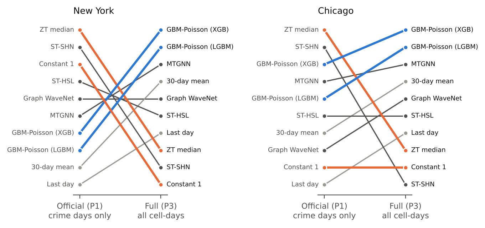
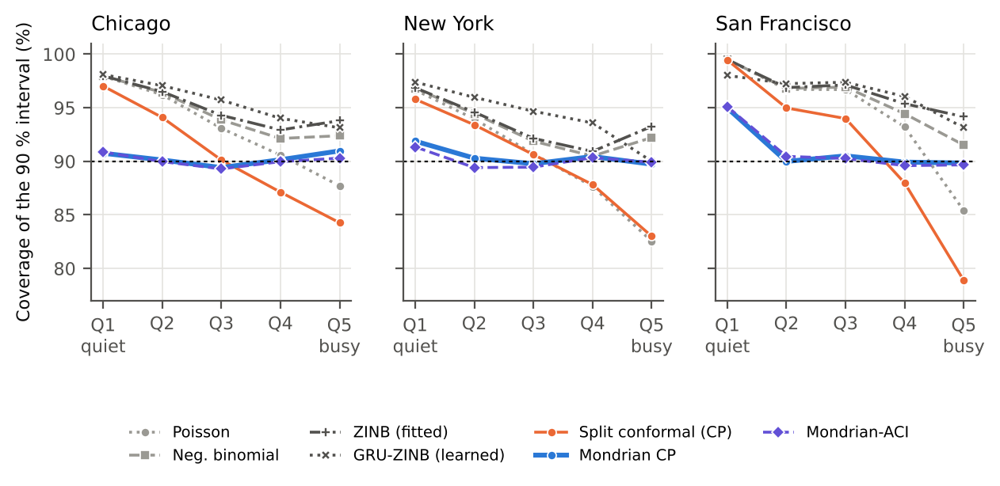

# Scoring only where crime happened

**An audit of evaluation practice in deep spatio-temporal crime forecasting, and calibrated count forecasts for three U.S. cities**

Sondip Poul Singh · Susmoy Bless Singh

[](LICENSE)


---

Deep crime-prediction models are compared on a public NYC/Chicago benchmark using MAE and MAPE computed **only on cell-days on which a crime occurred**. Because 68–89 % of test cell-days have no crime, the published numbers measure something other than forecasting. This repository contains everything needed to reproduce our audit of that practice and our recommended alternative: three Kaggle notebooks, all result tables, figures and run logs, and the manuscript source.

## Key findings

| | Finding |
|---|---|
| **Metric exploit** | A constant forecast of 1 beats the published MAPE of the state of the art (ST-HSL) in **8/8** city–category cells; a zero-truncated Poisson median beats the published MAE of **every** published model. |
| **Rankings** | Rankings under the official metric are unrelated to rankings on all cell-days and on a top-10 % hot-spot hit rate (Kendall's τ from −0.47 to 0.29). The full-task and hot-spot rankings agree (τ ≥ 0.87). |
| **Simple beats deep** | On all cell-days a gradient-boosted Poisson model beats every re-run deep model (ST-HSL, ST-SHN, Graph WaveNet, MTGNN) in every seed and on 83–92 of 92 test days. |
| **Reproduction** | ST-HSL's published accuracy is reproduced only with its official random seed in New York (other seeds 1.7–15.1 % worse) and by no seed in Chicago. |
| **Census** | All **6/6** public crime-count codebases we audited (2021–2026, incl. an ICLR 2026 model) score only non-zero cells. |
| **Intervals** | On weekly panels for Chicago, New York and San Francisco, Mondrian conformal intervals never fall more than 1.2 points below 90 % in any volume quintile; Poisson and split-conformal intervals under-cover busy places by up to 12 points; zero-inflated intervals (fitted or a learned GRU-ZINB) are conservative and 14–37 % wider. Mondrian-ACI stays within 1.3 points through 2020. Coverage is equal across poorer and richer areas. |

<p align="center">
  <br>
  <em>Model ranks change completely when all cell-days are scored.</em>
</p>

<p align="center">
  <br>
  <em>Coverage of 90 % intervals by series volume: only the Mondrian variants hold 90 % for quiet and busy places alike.</em>
</p>

## Repository layout

```
crime-forecasting-audit/
├── notebooks/
│   ├── 01_main_run_v1.ipynb          # benchmark audit, weekly forecasts, intervals, rolling origins (≈3 h on a T4)
│   ├── 02_patch_run_v2.ipynb         # 5 seeds, longer ST-SHN, census-based equity check (≈7 h)
│   └── 03_zinb_and_census_v3.ipynb   # protocol census of 7 repositories, ZINB baselines (≈45 min)
├── scripts/
│   ├── analysis_decision.py          # decision protocol P4 (hit rate / PAI) and day-block bootstrap
│   ├── make_tables.py                # builds every LaTeX table of the paper from results/tables
│   └── make_figures.py               # builds every figure of the paper from results/tables
├── results/
│   ├── tables/                       # all result tables (CSV) – see results/README.md
│   ├── figures/                      # notebook figures (PNG)
│   ├── predictions/                  # benchmark test predictions of every model and seed; weekly test predictions
│   ├── census/                       # ACS 2022 tract files and Census gazetteers used for the equity check
│   ├── logs/                         # progress logs, status and environment of the three runs
│   └── results_summary.md            # all hypotheses with verdicts and the main tables
├── paper/                            # manuscript (elsarticle, CEUS), tables, figures, highlights
└── docs/
    ├── reproduce.md                  # step-by-step reproduction on Kaggle
    ├── protocol.md                   # the evaluation protocol we recommend
    └── internal_review.md            # referee-style review of the draft and how it was addressed
```

## Reproducing the results

Everything runs on a free Kaggle GPU (T4). The full chain is described in [`docs/reproduce.md`](docs/reproduce.md); in short:

1. **Run 1** – import `notebooks/01_main_run_v1.ipynb` into Kaggle, set *Accelerator: GPU T4* and *Internet: On*, and *Save & Run All*. Download `optionA_outputs.zip`.
2. **Run 2** – add the run-1 output as a dataset input, add a free [Census API key](https://api.census.gov/data/key_signup.html) as the Kaggle secret `CENSUS_API_KEY`, and run `02_patch_run_v2.ipynb`.
3. **Run 3** – add the run-2 output as input and run `03_zinb_and_census_v3.ipynb`.
4. **Paper tables and figures** (local, no GPU):

```bash
pip install -r requirements.txt
python scripts/analysis_decision.py results          # writes results/tables/h01–h04
python scripts/make_tables.py results paper          # writes paper/tables/*.tex
python scripts/make_figures.py results paper         # writes paper/figures/*.pdf
```

Every notebook downloads its data itself (benchmark files from the official repositories, incidents from the Chicago, New York City and San Francisco open-data portals, ACS data from the Census API), saves each part as soon as it finishes, and judges the hypotheses that were fixed before the run automatically (`results/tables/z01_hypothesis_verdicts.csv`).

## Data sources

| Data | Source | Used for |
|---|---|---|
| NYC-/CHI-Crimes benchmark | [ST-HSL repository](https://github.com/LZH-YS1998/STHSL) (identical files in [ST-SHN](https://github.com/akaxlh/ST-SHN)) | benchmark audit |
| Chicago crimes 2016–2026 | [data.cityofchicago.org](https://data.cityofchicago.org/) (`ijzp-q8t2`) | weekly panels, 77 community areas |
| New York complaints 2016–2026 | [data.cityofnewyork.us](https://data.cityofnewyork.us/) (`qgea-i56i`, `5uac-w243`) | weekly panels, 77 precincts |
| San Francisco incidents 2018–2026 | [data.sfgov.org](https://data.sfgov.org/) (`wg3w-h783`) | weekly panels, 41 neighbourhoods |
| American Community Survey 2018–2022 | [U.S. Census Bureau API](https://www.census.gov/data/developers.html) | equity check |

Models re-run from their official code: [ST-HSL](https://github.com/LZH-YS1998/STHSL), [ST-SHN](https://github.com/akaxlh/ST-SHN), [Graph WaveNet](https://github.com/nnzhan/Graph-WaveNet), [MTGNN](https://github.com/nnzhan/MTGNN). The exact commits and the minimal patches are recorded in `results/tables/b01_code_versions_and_patches.csv`.

## Responsible use

All models forecast counts for places and weeks, never for individuals, and use no individual-level data. Recorded crime reflects reporting and enforcement as well as offending; forecasts of it can reproduce enforcement patterns. We report calibration and error across poorer and richer areas for this reason, and we do not recommend operational use without such checks.

## Citation

If you use this code or these results, please cite the repository (see [`CITATION.cff`](CITATION.cff)); the paper reference will be added on publication.

## License

Code: [MIT](LICENSE). The data are public and remain under the terms of their providers; the re-run models remain under their authors' licences.
